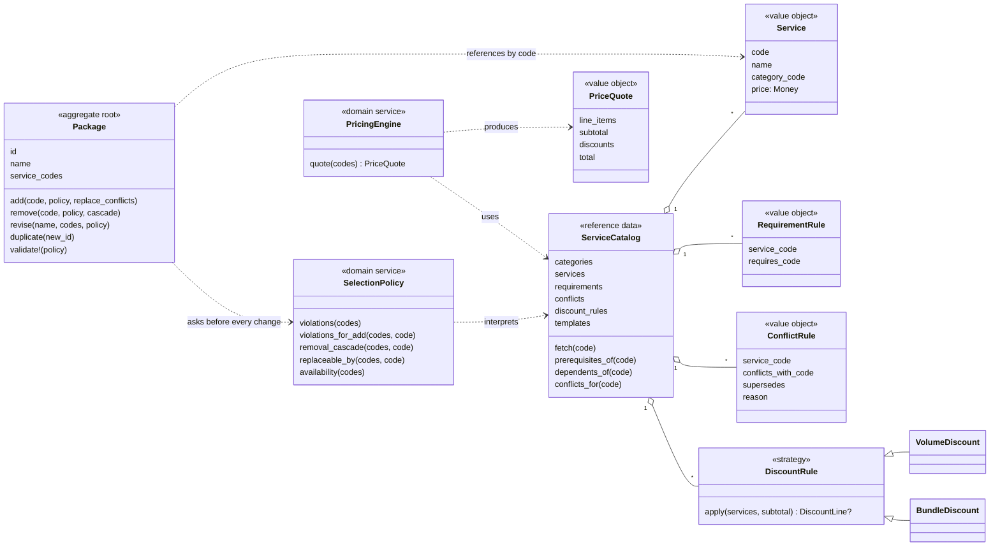
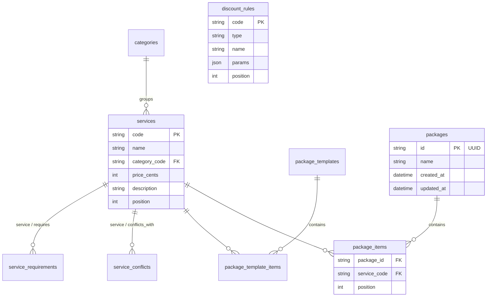

# Domain model

## Shared vocabulary

These terms mean the same thing in the code, the API and these docs.

| Term | Meaning |
|---|---|
| **Service** | A screening product that can be added to a package (e.g. *State Criminal Search*). Identified by a stable `code` |
| **Catalog** | The set of services on offer plus the rules about them. Reference data |
| **Requirement** | *A requires B*: A may only be in a package that also contains B |
| **Conflict** | A and B may not be in the same package. If A **supersedes** B, A includes everything B covers, so A can replace B |
| **Package** | A named, ordered selection of services that the user builds and saves |
| **Selection** | The service codes in a package (saved or not) |
| **Violation** | A broken rule, phrased for the end user |
| **Availability** | Whether a service can be added to the current selection: `available`, `selected`, `blocked` (missing prerequisite) or `conflict` |
| **Cascade** | The selected services that must also be removed when a prerequisite is removed |
| **Quote** | The calculated price: line items, subtotal, itemized discounts, total |
| **Discount rule** | A strategy that may produce one discount line: *volume* (percentage by service count) or *bundle* (flat amount when a whole set is selected) |
| **Template** | A predefined selection used as a starting point. Its price is always calculated, never stored |

## Model

## Package invariants

The `Package` aggregate checks these on every change. A change that would break one raises `Domain::ValidationError` carrying **all** the violations, and the package is left unchanged.

1. The name is present and at most 100 characters.
2. At least one service is selected, with no duplicates and no unknown codes.
3. Every selected service's prerequisites are also selected.
4. No two selected services conflict.

Changes that need the user's agreement have to be requested explicitly: `remove(..., cascade: true)` and `add(..., replace_conflicts: true)` (see [ADR 0005](adr/0005-dependent-removal-and-conflict-ux.md)).

## Where each concept lives

| Concept | Backend | Frontend |
|---|---|---|
| Rules (data) | `services`, `service_requirements`, `service_conflicts` tables; `SequelCatalogRepository` | Received from `GET /api/catalog` |
| Rule interpretation | `SelectionPolicy` (has final say on save) | `selectionRules.ts` (instant feedback; the same rule data, interpreted generically) |
| Pricing | `PricingEngine` + discount strategies (**the only implementation**) | Shows the result of `POST /api/packages/evaluate` |
| Package lifecycle | `Package` aggregate, `PackageService` use cases, `SequelPackageRepository` | `builderReducer` (draft state), `usePackageBuilder` |

## Database schema

